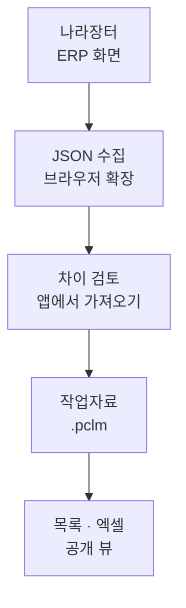

# 계약 목록 · pclm

**나라장터의 접수·공고·계약을 모아, 업무 목록과 문서 생성용 데이터로 씁니다.**

브라우저 확장으로 나라장터 ERP 화면의 데이터를 JSON으로 수집해 Windows 앱에서 검토하고, 하나의 SQLite 작업자료에 저장합니다.
진행상태·담당자·메모 같은 업무 열을 더하고, 엑셀로 내보내거나 문서 자동 생성기에서 읽을 수 있습니다.
나라장터 ERP의 DB에 직접 접근할 수 없는 업무를 위한 도구입니다.

**[처음 사용하기](#처음-사용하기)** · [개발 환경](#개발-환경) · [데이터셋 규약](docs/dataset-contract.md) · [설계 결정](docs/adr.md)



같은 문서 번호와 차수를 다시 가져오면 기존 자료와 비교합니다. 접수 → 공고 → 계약의 관계는
수집한 **명시 참조**로 구성하고, 사람이 고친 값은 수집 원본과 분리해 보관합니다.

## 처음 사용하기

기본 배포 대상은 **Windows x64**이며, **Microsoft Edge WebView2 런타임**이 필요합니다. 배포본은 `계약목록.exe` 하나이며,
.NET 런타임을 포함합니다. 소스에서 실행하려면 아래 [개발 환경](#개발-환경)을 참고하세요.

1. `계약목록.exe`를 계속 사용할 폴더에 두고 실행합니다. 처음 실행하면 작업자료를 만듭니다.
2. **나라장터 → 확장 준비**를 누릅니다. 앱이 확장 파일을 꺼내고 Chrome/Edge와의 연결을 등록합니다.
3. 브라우저 확장 관리에서 **개발자 모드 → 압축해제된 확장 프로그램 로드**를 선택하고,
   앱에 표시된 폴더를 추가합니다. Chrome과 Edge를 모두 쓰면 각각 추가합니다.
4. 나라장터의 지원 업무 화면을 엽니다. 앱 오른쪽 **지금 보는 화면**에서 자료와 차이를 확인하고 가져옵니다.
5. **통합**에서 접수·공고·계약을 확인합니다. **열 관리**로 업무 열을 추가하거나 표에서 엑셀로 내보냅니다.

**설정 → 자동 수집**에서 자동 저장을 켭니다. 이름을 입력하면 현재 화면의 담당자 값에 입력한 이름이 포함될 때만 저장하고,
이름을 비우면 담당자와 관계없이 현재 지원 화면을 자동 수집합니다. 기본은 꺼짐이며 현재 읽힌 자료만 저장하고 탭을 자동으로 누르지 않습니다.

같은 화면 데이터를 저장한 JSON 파일도 **나라장터 → JSON 파일로 가져오기…**에서 열어 미리보기·검토·저장할 수 있습니다.
확장의 실시간 수집과 JSON 파일 가져오기는 같은 활성 매핑과 저장 절차를 사용합니다. 지원 화면과 상세 설치 절차는
[통합 수집 안내](docs/erp/integration.md)에 있습니다.

> 확장은 나라장터 탭과 앱을 잇는 다리이며, 자료 검토와 저장은 앱에서 합니다.
> 로컬 확장 설치는 처음 한 번 직접 해야 합니다. 조직 정책이 개발자 모드나 Native Messaging을 막으면 사용할 수 없습니다.

## 할 수 있는 일

| 작업 | 제공하는 기능 |
| --- | --- |
| 자료 수집 | 접수·공고·계약의 화면/JSON 수집, 활성 매핑 관리, 기존 자료와 차이 검토 |
| 목록 관리 | 통합 구조·표 보기, 문서별 목록과 차수, 검색·정렬·행 선택·셀 범위 복사 |
| 업무 값 편집 | 입력열·가공열, 수집값 정정과 복원, 여러 행에 같은 값 입력, 엑셀 값 붙여넣기 전 검토 |
| 문서용 보기 | 필요한 필드를 모은 맞춤 뷰, 값 흐름 편집·미리보기, 보기 구성을 JSON으로 공유 |
| 파일 교환 | 검색 결과·선택 행·전체 자료 엑셀 내보내기, `.pclm` 제출본 생성·취합, 다른 자료 읽기 전용 열람 |

### 가져온 값과 사람이 고친 값

- 새 값과 바뀐 값은 가져오고, **빈값으로 지우기·정정값 복원·사라진 행 삭제는 고를 때만** 적용합니다.
- 사용자 입력은 본번호 전체에, 수집값 정정은 해당 차수에 적용합니다. 다시 수집해도 정정값을 조용히 덮지 않습니다.
- 수정 가능한 칸은 `F2` 또는 타자로 편집하고, `Enter`·`Tab`으로 저장합니다.
  수집값 정정은 `Ctrl+Delete`로 원래 값으로 돌립니다. `Ctrl+C`·`Ctrl+V`로 셀 범위를 복사·붙여넣습니다.
- 자료 삭제는 행 체크박스로 대상을 고르고 영향을 검토한 뒤 실행합니다. 삭제한 자료도 다시 수집하면 들어옵니다.

입력열은 글·선택·날짜·숫자를 담고, 가공열은 품목·이 행·연결 문서에서 값을 계산합니다.
[열 관리](docs/column-management.md)와 [맞춤 뷰](docs/user-views.md)에 편집 방식과 제한을 설명합니다.

## 자료 보관과 외부 연동

**작업자료는 `.pclm` 파일 하나입니다.** 내용은 SQLite이며, 기본 위치는
`%LOCALAPPDATA%\Pclm\계약자료.pclm`입니다. 홈의 `config.json`이 현재 작업자료의 경로를 가리키고,
앱·명령줄·확장 호스트가 같은 설정을 사용합니다. 현재 위치는 **설정 → 저장 위치**에서 확인합니다.

| 목적 | 앱에서 할 일 |
| --- | --- |
| 저장 위치 변경 | **작업자료 옮기기** |
| 다른 자료로 작업 시작 | **작업자료 바꾸기** 또는 **새 계약자료** |
| 현재 시점 보관 | **백업 만들기** — 스키마 판올림 전에도 홈의 `backups`에 백업합니다 |
| 받은 자료 확인 | **다른 자료 열어 보기** — 사본을 읽기 전용으로 열어 원본을 보존합니다 |
| 여러 사람의 자료 취합 | **설정 → 제출·취합** — 제출본을 모아 취합본과 충돌 결과 `.txt`를 만듭니다 |

설정이 깨졌거나 작업자료가 사라지면 빈 자료로 대신 열지 않습니다. 앱에서 파일을 찾거나 새로 만들도록 안내합니다.
작업자료 교환과 백업은 앱의 기능을 사용하세요. DB는 WAL 모드이므로 실행 중인 파일을 임의로 복사하는 방식은 피하세요.

각자 로컬 작업자료를 쓰고 제출본을 교환합니다. 네트워크 드라이브의 DB 하나를 공동 편집하는 방식은 지원하지 않습니다.
취합은 매번 제출본에서 새로 만들며, 같은 문서·입력값이 겹치면 수정시각이 늦은 쪽을 싣고 밀려난 항목을 결과 `.txt`에 기록합니다.
취합본은 다시 만들 수 있는 결과물입니다. 수정하려면 **작업자료 바꾸기**로 사본을 새 작업자료로 삼습니다.

문서 자동 생성기 등 외부 소비자는 **읽기 전용 연결과 공개 뷰**를 사용해야 합니다.
`v_통합`·`v_계약` 같은 문서 뷰, 품목 뷰, 차수 뷰와 `u_<이름>` 맞춤 뷰의 의미는
[데이터셋 규약](docs/dataset-contract.md)이 정합니다. 내부 테이블은 연동 규약이 아닙니다.
사용자 열은 설치마다 달라질 수 있으므로 열 이름으로 연결해야 합니다. 뷰·열 이름은 제자리에서 변경될 수 있어,
소비자도 필요한 필드가 있는지 확인해야 합니다([ADR-034](docs/adr.md)).

### 사용 전 알아둘 점

- **화면에 로딩된 범위만 수집합니다.** 지원 화면도 제한되어 있으며, 현재 화면 엑셀 내보내기도 전체 조회 결과를 보장하지 않습니다.
- **문서 관계는 명시 참조로만 만듭니다.** 이름·수량·단가 유사도로 추천하거나 수동 연결하지 않습니다.
  참조가 없거나 대상이 아직 수집되지 않으면 해당 연결은 비어 있습니다.
- **PDF 가져오기는 제거했습니다.** 계획·현황과 계획 엑셀 UI는 동결해 숨겼으며, 관련 데이터와 CLI 코드는 보존합니다.
- **엑셀 내보내기는 그 시점의 사본입니다.** 내보낸 파일을 고쳐도 DB에 반영되지 않습니다.
- **주민등록번호는 수집하지 않습니다.** 상호·사업자등록번호·대표자명 등 계약 사업체 정보는 저장합니다.
- 앱을 옮기거나 업데이트하면 실행 시 확장 파일과 연결 경로를 갱신합니다. 브라우저가 기존 exe를 잡아 교체가 막히면
  그 파일을 `계약목록.old.exe`로 바꾸고 새 exe를 놓습니다. 자세한 절차는 [확장 안내](docs/erp/integration.md#chrome--edge-확장)를 참고하세요.

## 개발 환경

필요한 도구는 **Windows, .NET 8 SDK, Node.js/npm, WebView2 런타임**입니다.
.NET SDK 선택은 [global.json](global.json), 프런트엔드 의존성은 [package-lock.json](package-lock.json)에 고정합니다.

저장소 루트의 PowerShell에서 실행합니다.

```powershell
npm ci
npm run build
./run.ps1 -HomeDir artifacts/dev-home
```

이 명령은 화면을 빌드하고 **별도 개발 홈**으로 앱을 엽니다. 홈 안에 빈 작업자료가 생깁니다.
`-HomeDir` 없이 `./run.ps1`을 실행하면 실제 업무 홈을 사용하므로 주의하세요.

| 명령 | 실행 방식 |
| --- | --- |
| `./run.ps1 -Dev` | Vite 개발 서버 + 실제 앱 다리·DB. 기본 홈은 `artifacts/dev-home` |
| `./run.ps1 -HomeDir artifacts/dev-home` | 빌드된 화면 + 실제 앱 다리·DB. 화면이 오래되었으면 다시 빌드 |
| `npm run dev` | 브라우저에서 화면만 개발. 가짜 다리를 사용하므로 실제 DB 연동 검증은 불가 |
| `./run.ps1 -Cli -HomeDir artifacts/dev-home status` | 같은 개발 홈의 자료를 명령줄로 확인 |

화면 산출물 `src/Pclm.App/wwwroot`는 저장소에 포함하지 않습니다. 직접 .NET 앱을 빌드할 때도
`npm run build`를 먼저 실행하세요. Debug 앱은 `F12`로 개발자 도구를 열 수 있고, Release에서는 비활성화합니다.

### 빌드와 검증

```powershell
npm run build                         # TypeScript 검사 + 화면 빌드
npm test                              # 화면 시험
dotnet build                         # .NET 빌드
dotnet test tests/Pclm.Core.Tests     # 핵심 로직·저장·수집·뷰 규약 시험
```

공개 뷰의 열 이름·순서는 `tests/Pclm.Core.Tests/contract/views.txt`와 대조합니다.
규약 변경으로 기준 파일을 갱신할 때만 `PCLM_UPDATE_GOLDEN=1`을 사용하고, 변경 내용을 직접 확인하세요.

### 명령줄

명령줄은 배포 exe에 포함하지 않습니다. 개발 환경에서 `./run.ps1 -Cli` 뒤에 명령을 붙입니다.
전체 사용법은 `./run.ps1 -Cli help`로 확인합니다.

| 명령 | 용도 |
| --- | --- |
| `status` | 저장 위치·자료 수·차수 확인 |
| `export [경로]` | 전체 자료 엑셀 내보내기 |
| `set [키 열 값]` / `fix <키> <열> [값]` | 사용자 입력 / 수집값 정정·복원 |
| `delete <키> [--계열] [--예]` | 삭제 영향 확인. `--예`를 붙여야 실제 삭제 |
| `submit [경로]` / `merge <폴더 또는 파일…>` | 제출본 생성 / 취합본 생성 |

`--home <폴더>`로 홈을 분리하고, `--file <파일>`은 `status`·`현황`·`export`에서만 읽기 전용 열람에 씁니다.
예전 `--db` 옵션은 지원하지 않습니다. `plan`·`현황`은 동결된 계획 기능의 CLI 입구로 남아 있습니다.

### 배포본 만들기

```powershell
./publish.ps1           # 화면 빌드 → 단일 exe → ZIP
./publish.ps1 -NoZip    # 폴더만 생성
```

기본 출력은 `dist/계약목록/계약목록.exe`와 `dist/계약목록_<버전>_win-x64.zip`입니다.
버전은 [Directory.Build.props](Directory.Build.props) 한 곳에서 관리합니다.
스크립트는 화면과 SQLite 네이티브 라이브러리를 포함한 self-contained 실행 파일을 만들고,
출력 폴더에 exe 외 파일이 남으면 실패합니다. WebView2 런타임은 별도로 필요합니다.
서명하지 않은 실행 파일은 Windows SmartScreen 경고가 표시될 수 있습니다.

## 코드와 문서

| 경로 | 역할 |
| --- | --- |
| `src/Pclm.Core` | 자료 모델, ERP 매핑·수집, SQLite 저장·뷰·엑셀·취합 |
| `src/Pclm.App` | WPF + WebView2 창. `Bridge.cs`가 화면과 앱을 연결 |
| `src/Pclm.Cli` | 개발용 명령줄 |
| `frontend` | Vite + React 화면, 표·구조 보기·열 관리·맞춤 뷰 |
| `tests/Pclm.Core.Tests` | 핵심 기능과 외부 데이터 규약 검증 |

- [통합 수집 안내](docs/erp/integration.md) — 지원 화면, JSON 매핑, 확장 설치·개발
- [데이터셋 규약](docs/dataset-contract.md) — 외부 소비자가 의존할 뷰와 파일 규칙
- [열 관리](docs/column-management.md) · [맞춤 뷰](docs/user-views.md) — 업무 열과 서식용 데이터 구성
- [설계 결정 기록](docs/adr.md) — 채택한 설계와 변경 이유

## 라이선스

[MIT](LICENSE). 함께 배포하는 런타임·라이브러리·글꼴의 고지는
[THIRD-PARTY-NOTICES.txt](THIRD-PARTY-NOTICES.txt)에 있으며, 앱의 **설정 → 라이선스 정보**에서도 볼 수 있습니다.
운영 의존성이나 글꼴을 추가·변경하면 고지도 함께 갱신해야 합니다.
