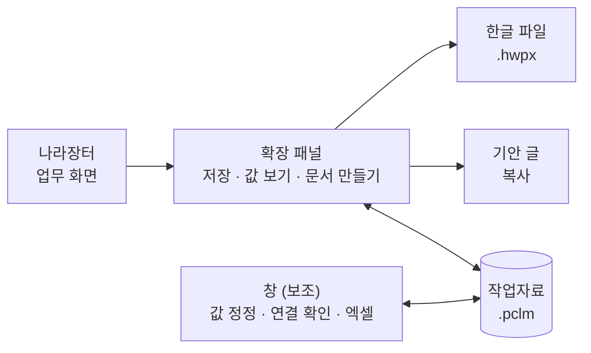

# 계약 목록 · pclm

**나라장터 화면을 보다가, 그 건의 문서를 바로 만듭니다.**

브라우저 확장의 「문서 만들기」 패널이 지금 연 접수·공고·계약 화면의 건으로 서식을 채워 한글 파일이나 기안 글을 만듭니다.
문서에 쓰는 값은 먼저 작업자료(SQLite)에 저장되어, 나중에 그 문서의 근거를 목록에서 찾을 수 있습니다.
Windows 창은 보조입니다 — 값 정정, 접수–공고–계약 연결 확인, 업무 열·엑셀 내보내기·대시보드에 씁니다.

**[처음 사용하기](#처음-사용하기)** · [창에서 하는 일](#창에서-하는-일) · [개발 환경](#개발-환경) · [데이터셋 규약](docs/dataset-contract.md) · [설계 결정](docs/adr.md)



접수 → 공고 → 계약의 관계는 수집한 **명시 참조**로 구성하고, 사람이 고친 값은 수집 원본과 분리해 보관합니다.

## 처음 사용하기

배포 대상은 **Windows x64**이며 **Microsoft Edge WebView2 런타임**이 필요합니다. 배포본은 `계약목록.exe` 하나입니다.

1. `계약목록.exe`를 계속 사용할 폴더에 두고 실행합니다. 처음 실행하면 작업자료를 만듭니다.
2. 창의 **나라장터 → 확장 준비**를 누릅니다. 앱이 확장 파일을 꺼내고 Chrome/Edge와의 연결을 등록합니다.
3. **Chrome 확장 관리 열기**(또는 Edge)에서 **개발자 모드**를 켜고 **압축해제된 확장 프로그램을 로드합니다**로
   창에 표시된 확장 폴더를 고릅니다. 두 브라우저를 모두 쓰면 각각 추가합니다.
4. 나라장터의 계약요청 접수·입찰공고·계약서 화면에서 화면 오른쪽 아래의 **문서 만들기** 단추나 툴바의 확장 단추를 누르면 브라우저 옆에 패널이 열립니다.
5. 화면이 계약목록에 저장된 것과 다르면(새 건·새 차수·바뀐 칸) 무엇이 다른지와 **계약목록에 저장** 단추만 보입니다.
   누르면 저장됩니다(창이 닫혀 있어도 됩니다). 이미 같으면 건너뜁니다.
6. **서식**에서 서식을 고르고 **채워질 값**을 확인합니다. 고를 문단이 있는 서식은 **포함할 내용**에서 고릅니다.
7. 한글 서식은 **한글 파일로 저장**(폴더를 고르지 않았으면 「다운로드\계약문서」 에 저장됩니다), 글 서식은 **글 복사**로 결재 시스템 본문에 붙여 넣습니다.

**서식.** 서식은 **문서\계약문서 서식** 폴더의 파일입니다 — 패널의 **설정 → 서식 → 폴더 열기**로 엽니다. 한글이나 메모장에서 고쳐 저장하면
패널을 다시 열거나 **이 화면 다시 확인**을 누를 때 그대로 반영됩니다. 새 서식은 그 폴더에 `.hwpx`(한글은 빈칸을 누름틀로)나 `.txt`(글은 `{{건명}}`처럼)
파일로 두고, 칸 이름은 [문서 만들기 어휘](docs/document-vocabulary.md)를 따릅니다. 동봉 서식은 「물품 구매입찰 공고」(한글), 「계약방법 결정 및 구매추진 안내」·「낙찰자 선정 및 계약체결 안내」(글)로,
폴더에 없을 때만 채워지고 있는 파일은 덮어쓰지 않습니다. 설정에서 서식의 순서를 바꾸고(끌거나 ↑·↓) 쓰지 않는 서식을 숨깁니다. 읽지 못한 서식은 그 줄에 까닭이 보이고 고를 수 없습니다.
패널의 **설정**(부서·이름·연락처·저장 폴더, 서식의 순서·숨김)과 서식마다의 파일 이름은 그 브라우저의 확장에만 저장됩니다. 설정은 칸을 떠날 때 저절로 저장됩니다.
한글 파일 이름은 **서식마다** 정합니다 — 아랫단 파일 이름 줄의 연필을 눌러 고른 서식의 규칙을 통합 뷰의 열 `{{칸 이름}}`·`{{서식이름}}`·`{{date:YYYYMMDD}}`로 적고, 비우면 그 서식의 기본으로 돌아갑니다. 기본은 「물품 구매입찰 공고」 가 `공고서-({{입찰공고번호}})-{{공고명}}`, 그 밖의 서식은 `{{건명}}_{{서식이름}}` 입니다.

**자동 수집.** 창의 **설정 → 자동 수집**에서 켜면 앱이 실행 중인 동안 열어 둔 지원 화면을 저장해, 패널이 대개 곧장 값 보기로 갑니다.
패널 설정의 내 정보 이름이 화면의 담당자 값에 있을 때만 저장하고(이름이 없으면 저장하지 않습니다), 접수 화면은 자동으로 저장하지 않습니다. 기본은 꺼짐입니다.

> 상세는 [통합 수집 안내](docs/erp/integration.md)에 있습니다. 조직 정책이 개발자 모드나 Native Messaging을 막으면 쓸 수 없습니다.

### 알아둘 점

- **빈 칸은 문서에 【확인 필요】로 남습니다.** 값이 맞는지는 기계가 판정하지 않고, 원본을 보는 사람이 채웁니다.
- **한 공고에 계약이 여럿이면** 계약마다 다른 칸은 비워 둡니다. 계약 화면에서 만들면 그 계약으로 채웁니다.
- **공고 탭에서는 화면의 그 공고로 채웁니다** — 재공고·취소공고로 공고가 여럿이어도 그렇습니다. 접수·계약 탭은 그 건의 현행 공고입니다.
- **옛 차수 화면에서는 만들지 않습니다.** 최신 차수를 여세요.
- **저장할 수 없는 화면**(품목 대응을 골라야 하는 등)은 창 오른쪽 **지금 보는 화면**에서 확인해 가져옵니다.
- **화면에 로딩된 범위만 수집합니다.** 현재 화면 엑셀 내보내기도 전체 조회 결과를 보장하지 않습니다.
- **문서 관계는 명시 참조로만 만듭니다.** 유사도 추천·수동 연결은 없고, 참조가 없거나 대상이 미수집이면 비어 있습니다.
- **주민등록번호는 수집하지 않습니다.** 상호·사업자등록번호·대표자명 등 계약 사업체 정보는 저장합니다.

## 창에서 하는 일

| 작업 | 창에서 |
| --- | --- |
| 값 정정 | 표에서 수집값을 고치고 복원, 여러 행에 같은 값 입력, 엑셀 값 붙여넣기 전 검토 |
| 연결 확인 · 대시보드 | **대시보드**의 **브리핑**(진행 단계·납품기한), **구조**(접수·공고·계약 한 줄), **전체 차수** |
| 업무 열 | **열 관리**로 진행상태·메모 같은 입력열을 더함 |
| 엑셀 내보내기 | 표의 검색 결과·선택한 행, **설정 → 자료 관리 → 전체 자료 내보내기** |
| 가져오기 | 오른쪽 **지금 보는 화면**에서 차이를 검토해 저장, **나라장터 → JSON 파일로 가져오기…** |

### 가져온 값과 사람이 고친 값

- 새 값과 바뀐 값은 가져오고, **빈값으로 지우기·정정값 복원·사라진 행 삭제는 고를 때만** 적용합니다.
- 사용자 입력은 본번호 전체에, 수집값 정정은 해당 차수에 적용합니다. 다시 수집해도 정정값을 조용히 덮지 않습니다.
- 칸은 `F2` 또는 타자로 편집하고 `Enter`·`Tab`으로 저장합니다. 수집값 정정은 `Ctrl+Delete`로 원래 값으로 돌립니다.
- 자료 삭제는 행 체크박스로 대상을 고르고 영향을 검토한 뒤 실행합니다. 삭제한 자료도 다시 수집하면 들어옵니다.
- **엑셀 내보내기는 그 시점의 사본입니다.** 내보낸 파일을 고쳐도 DB에 반영되지 않습니다.

입력열의 편집 방식은 [열 관리](docs/column-management.md)에 있습니다. **사용자 뷰**(사이드바 **뷰 만들기**)와 가공열은
흐름식·SQL로 열을 엮는 개발자 도구로, 고급 사용자에게 열어 둡니다. 패널이 읽는 통합 뷰(「문서 서식」)도 이것으로 짜서 exe 에
실은 것이라, 패널은 작업자료에 깔린 사본을 읽지 않습니다 — [맞춤 뷰](docs/user-views.md).

## 자료 보관

**작업자료는 `.pclm` 파일 하나입니다.** 내용은 SQLite이며 기본 위치는 `%LOCALAPPDATA%\Pclm\계약자료.pclm`입니다. 홈의 `config.json`이
현재 작업자료를 가리키고 창·명령줄·확장 호스트가 같은 설정을 씁니다. 현재 위치는 **설정 → 자료 관리**에서 확인합니다.

| 목적 | 창에서 할 일 |
| --- | --- |
| 저장 위치 변경 | **작업자료 옮기기** |
| 다른 자료로 작업 시작 | **작업자료 바꾸기** 또는 **새 계약자료** |
| 현재 시점 보관 | **백업 만들기** — 스키마 판올림 전에도 홈의 `backups`에 백업합니다 |
| 받은 자료 확인 | **다른 자료 열어 보기** — 사본을 읽기 전용으로 열어 원본을 보존합니다 |

설정이 깨졌거나 작업자료가 사라지면 빈 자료로 대신 열지 않고 파일을 찾거나 새로 만들도록 안내합니다. DB는 WAL 모드이므로
실행 중인 파일을 임의로 복사하지 말고 앱의 기능을 쓰세요. 네트워크 드라이브의 DB 하나를 공동 편집하는 방식은 지원하지 않습니다.

## 바깥 프로그램이 읽을 때

문서나르미 같은 바깥 프로그램은 **읽기 전용 연결과 공개 뷰**를 씁니다. 문서 뷰(`v_통합`·`v_계약` 등)·품목 뷰·차수 뷰의 의미는
[데이터셋 규약](docs/dataset-contract.md)이 정하고, 내부 테이블은 연동 규약이 아닙니다. 사용자 열은 설치마다 다르므로 열 이름으로 연결하고,
뷰·열 이름은 제자리에서 바뀔 수 있으니 필요한 필드가 있는지 확인해야 합니다([ADR-034](docs/adr.md)).

## 개발 환경

필요한 도구는 **Windows, Rust(rustup), Node.js/npm, WebView2 런타임**입니다. 의존은 [Cargo.lock](Cargo.lock)·[package-lock.json](package-lock.json)에
고정합니다. 저장소 루트의 PowerShell에서 실행합니다.

```powershell
npm ci
npm run build
./run.ps1 -HomeDir artifacts/dev-home
```

화면을 빌드하고 **별도 개발 홈**(빈 작업자료가 생깁니다)으로 앱을 엽니다. `-HomeDir` 없는 `./run.ps1`은 실제 업무 홈을 씁니다.

| 명령 | 실행 방식 |
| --- | --- |
| `./run.ps1 -Dev` | Vite 개발 서버 + 실제 앱 다리·DB. 기본 홈은 `artifacts/dev-home` |
| `./run.ps1 -HomeDir artifacts/dev-home` | 빌드된 화면 + 실제 앱 다리·DB. 화면이 오래되었으면 다시 빌드 |
| `npm run dev` | 브라우저에서 화면만 개발. 가짜 다리를 사용하므로 실제 DB 연동 검증은 불가 |
| `./scripts/fake-g2b.ps1` | 가짜 나라장터 페이지 + 확장을 올린 브라우저. 확장·호스트·앱·DB는 진짜(개발 홈 `%LOCALAPPDATA%\Pclm.Erp.Dev`, 서식 폴더는 그 아래 `서식`) |

창은 `crates/pclm-desktop`(Rust + Tauri 2)입니다. 화면 산출물 `artifacts/web`와 문서 만들기 엔진 `extension/engine.wasm`은 저장소에 없는
빌드 산출물로 exe 안에 박히므로, `run.ps1`·`publish.ps1` 이 창보다 먼저 짓습니다. Debug 앱은 `F12`로 개발자 도구를 엽니다.

### 통합 뷰와 동봉 서식

- 패널이 읽는 통합 뷰는 `crates/pclm-core/src/storage/presets/builtin-views.json` 의 「문서 서식」이고, 그 열 이름이 서식의 칸 이름입니다. 창의 같은 이름 보기는 앱이 열 때마다 이 정의로 맞추고, 창에서 고쳐 저장하면 패널이 고친 것을 읽습니다 — 설정의 「문서 서식 처음 상태로…」가 되돌립니다(ADR-052).
- 동봉 서식은 `extension/templates/` 이고 exe 에 실려 서식 폴더에 없는 이름만 채워집니다(ADR-049) — 고쳐 내도 이미 그 파일을 가진 사람에게는
  닿지 않습니다. 한글 서식은 컴파일 전 모습(항목 표시가 글로 보이는 것)으로 둡니다. 동봉 서식의 기본 파일 이름 패턴은 `extension/templates.js` 의
  `NAME_PATTERNS`(파일 이름이 열쇠)입니다. 열의 다른 이름·내 정보는 `crates/pclm-doc-engine/vocabulary.json` 에 있습니다.
- 문서에 찍히는 글은 통합 뷰가 낸 글 그대로입니다 — 금액의 「원」·공문서 날짜·한글 금액·오늘도 그 뷰가 흐름식 「서식」 의
  엑셀 표시 형식 코드로 짓고(ADR-053), 엔진은 값을 바꾸지 않습니다(ADR-051).
- 동봉 공고서의 「① 계약담당자」 줄은 내 정보(`계약담당자`·`계약담당 전화번호`·`계약담당 팩스번호` — 내 이름·연락처·팩스의 다른
  이름)이고, 「② 수요기관 연락처」 줄은 통합 뷰의 `수요기관`·`담당부서`·`담당자`·`담당자 전화번호` 입니다. 패널은 내 정보 칸을 쓰는 서식에서 이름·연락처가 통합 뷰의
  `공고담당자`·`공고담당 전화번호` 와 다르면 알리기만 하고 막지 않습니다(`extension/panel/state.js` 의 `meMismatch`).
- `crates/pclm-doc-engine/tests/vocabulary.rs` 가 동봉 서식의 칸이 모두 통합 뷰의 열·내 정보인지 대조합니다.
  [어휘 표](docs/document-vocabulary.md)는 `cargo run -p pclm-doc-engine --example vocabulary_doc` 이 다시 짓는 생성물입니다.
- 엔진을 고치면 `./scripts/build-engine.ps1` 로 다시 지어야 `npm test` 의 패널 시험이 새 엔진을 봅니다.
- 조사 선택은 TXT의 `{{@조사:수요기관:은/는}}` 또는 HWPX 누름틀 이름 `@조사:수요기관:은/는`으로 지정합니다.
  대상 값은 그대로 두고 조사만 출력합니다. 한글 끝음절을 판정할 수 없거나 값이 없으면 병기를 남기고 확인을 요청합니다.
  지원 조사쌍·대상 이름 규칙은 [ADR-054](docs/adr.md#adr-054--조사-선택은-명시-대상-시스템-토큰-2026-11-15)에 있습니다.
- `./scripts/fake-g2b.ps1` 로 가짜 나라장터 앞에서 패널을 돌려 봅니다 — 화면 · 엔진 · 창을 짓고 개발 홈의 창까지 함께 띄웁니다(브라우저는 Edge 가 먼저, Chrome 이면 확장을 처음 한 번 손으로 올립니다). 탐색기에서는 옆의 `fake-g2b.bat` 을 두 번 누릅니다.

### 빌드와 검증

```powershell
npm run build                         # TypeScript 검사 + 화면 빌드
npm test                              # 화면 시험
cargo test --workspace                # Rust 시험(창 없이)
cargo clippy -p pclm-desktop --features shell -- -D warnings   # 창까지
```

Core의 저장·투영·뷰 시험은 빈 작업자료를 독립 파일로 복사해 준비합니다.
생성·판올림 시험은 실제 생성 경로를 직접 검증합니다.
시험 프로필은 외부 의존성만 최적화하므로 처음에는 의존성을 다시 빌드하지만, 작업 크레이트의 디버그 설정은 유지합니다.
2026-11-16 로컬 캐시 실행에서 기존 668개 시험이 모두 166.6초에 통과했습니다(빌드 0.83초, 시험 실행 합계 159.63초).

공개 뷰의 열 이름·순서는 `crates/pclm-core/tests/contract/views.txt`와 대조합니다. 규약 변경으로 기준 파일을 갱신할 때만
`PCLM_UPDATE_GOLDEN=1`을 쓰고, 변경 내용을 직접 확인하세요.

### 명령줄

명령줄은 배포 exe에 포함하지 않습니다. `./run.ps1 -Cli` 뒤에 명령을 붙이고, 전체 사용법은 `./run.ps1 -Cli help`로 확인합니다.

| 명령 | 용도 |
| --- | --- |
| `status` | 저장 위치·자료 수·차수 확인 |
| `export [경로]` | 전체 자료 엑셀 내보내기 |
| `set [키 열 값]` / `fix <키> <열> [값]` | 사용자 입력 / 수집값 정정·복원 |
| `delete <키> [--계열] [--예]` | 삭제 영향 확인. `--예`를 붙여야 실제 삭제 |

`--home <폴더>`로 홈을 분리하고(`./run.ps1 -Cli -HomeDir artifacts/dev-home status`), `--file <파일>`은 `status`·`export`에서만 읽기 전용 열람에 씁니다.

### 배포본 만들기

```powershell
./publish.ps1           # 엔진·화면 빌드 → 단일 exe → ZIP
./publish.ps1 -NoZip    # 폴더만 생성
```

출력은 `dist/계약목록/계약목록.exe`와 `dist/계약목록_<버전>_win-x64.zip`이고, 버전은 [Cargo.toml](Cargo.toml)의 `[workspace.package] version`
한 곳에서 관리합니다. 화면·확장·SQLite 를 품은 exe 하나가 창이자 브라우저 확장의 native messaging 호스트이며, 출력 폴더에 exe 외 파일이
남으면 실패합니다. 의존을 바꾸면 `./scripts/generate-crate-notices.ps1` 로 THIRD-PARTY-NOTICES.txt 의 Rust 크레이트 절을 다시 짓습니다.
서명하지 않은 실행 파일은 Windows SmartScreen 경고가 표시될 수 있습니다.

## 코드와 문서

| 경로 | 역할 |
| --- | --- |
| `extension` | 브라우저 확장 — 「문서 만들기」 사이드 패널 · 동봉 서식. exe 에 실려 나간다 |
| `crates/pclm-doc-engine` | 문서 만들기 엔진(문서나르미 hwpx-filler 를 덜어 낸 판) — wasm 으로 지어 확장에 싣는다 |
| `crates/pclm-core` | 자료 모델, ERP 매핑·수집, SQLite 저장·뷰 |
| `crates/pclm-desktop` | Tauri 2 창 · 브라우저 확장 호스트 — 배포되는 exe 하나 |
| `crates/pclm-bridge` | 화면과 앱 사이의 다리 |
| `crates/` 의 나머지 | `pclm-cli`(개발용 명령줄), `pclm-home`(홈 · 작업자료 바꾸기), `pclm-excel`(엑셀 쓰기), `pclm-host`·`pclm-erp-host`(native messaging 호스트) |
| `frontend` | Vite + React 화면 — 대시보드·표·열 관리·지금 보는 화면·뷰 |

- [통합 수집 안내](docs/erp/integration.md) — 지원 화면, JSON 매핑, 확장 설치·문서 만들기 패널
- [문서 만들기 어휘](docs/document-vocabulary.md) — 서식에 쓸 수 있는 칸 이름(통합 뷰의 열 · 내 정보)
- [데이터셋 규약](docs/dataset-contract.md) — 바깥 소비자가 의존할 뷰와 파일 규칙
- [열 관리](docs/column-management.md) · [맞춤 뷰](docs/user-views.md) — 업무 열, 가공열·사용자 뷰(개발자 도구)
- [설계 결정 기록](docs/adr.md) — 채택한 설계와 변경 이유

## 라이선스

[MIT](LICENSE). 함께 배포하는 런타임·라이브러리·글꼴의 고지는 [THIRD-PARTY-NOTICES.txt](THIRD-PARTY-NOTICES.txt)에 있으며,
앱의 **설정 → 라이선스 정보**에서도 볼 수 있습니다. 운영 의존성이나 글꼴을 추가·변경하면 고지도 함께 갱신해야 합니다.
